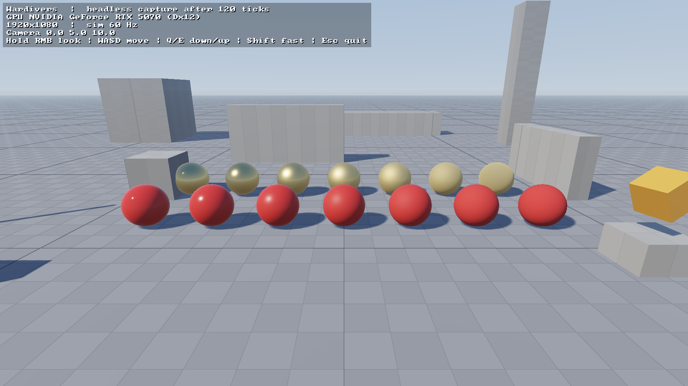

# Wardivers

A co-op PvE shooter prototype on a custom Rust engine. Personal project, started September 2026.

The source is private. I'm happy to walk through it or give access on request.

## What's built so far

- **Custom engine in Rust:** a wgpu renderer (instanced meshes, physically based sun and sky
  lighting, HDR with tonemapping, cascaded shadows), winit windowing and cpal audio
- **Fixed 60 Hz simulation**, separate from rendering, with interpolation between ticks
- **Online co-op for up to four players** over UDP: the host runs the game, and joining players
  predict their own movement and are corrected by the host's snapshots
- **Crowds of up to 400 AI enemies**, parallelised with Rayon and measured by a headless benchmark
- **292 automated tests**, plus headless capture and scripted scenarios that check every build

## How it's built

I own the design, the roadmap and the playtests, and I set the acceptance criteria each build step
has to meet. An AI coding agent (Claude) writes the code. Every step is checked against those criteria
by automated tests and hands-on playtesting, and every decision goes into a dated log.

© 2026 Shahil Parbhoo Narsing. All rights reserved.
